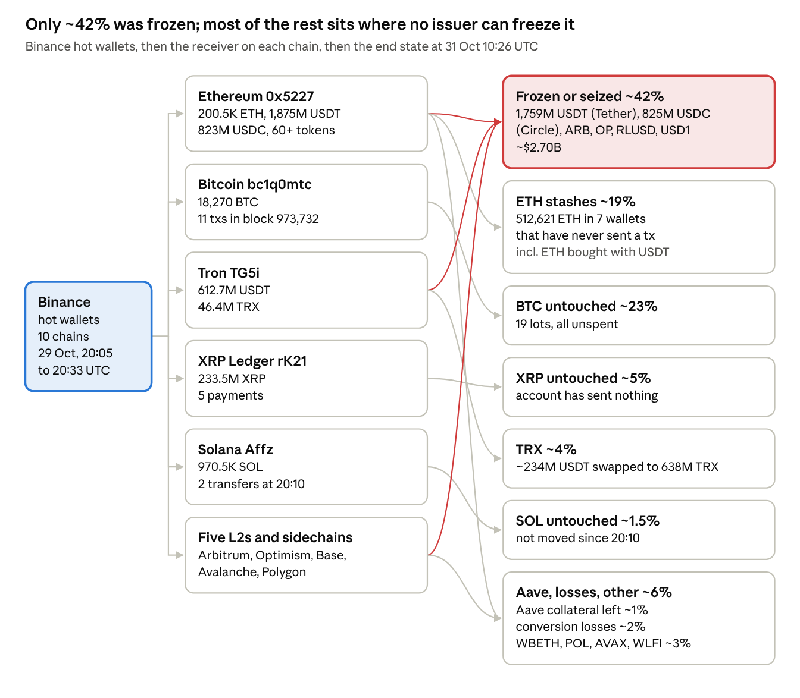

# Binance hot-wallet hack, 29 Oct 2026: the funds trace

An open, transaction-level record of where the roughly $6.36B stolen from Binance went, across ten chains. Built by [AtlasYield](https://atlasyield.club) Research from chain reads, with every row linked to a block explorer.

- **Read the story:** the article (link added on publication).
- **Read the full report:** [`REPORT.md`](REPORT.md). It has 15 sections: the address book, the timeline by chain, positions, bridges, freezes, the interpretation, the Aave impact, the end state, unverified leads and the later reads.
- **Use the data:** [`data/`](data). Everything is CSV, and the ledger is also in JSON.



## Headline numbers

| | |
|---|---|
| Stolen (TRM, at transfer prices) | about $6.36B across ten chains |
| Frozen or seized | about $2.70B (42%): 1.76B USDT, 824.7M USDC, Arbitrum and Optimism governance moves, RLUSD, USD1 |
| Time from the main Ethereum sweep to Tether's first freeze | 37 min 12 s |
| USDT converted to ETH before the freezes caught up | 435M USDT for 160,451 ETH, about $2,711 per ETH against a market near $2,300 |
| Aave V3 position opened in the race | 60M USDT supplied, 19,762 ETH borrowed, still open (health factor 1.0518 on 31 Oct) |
| ETH held, untouched | 516,849.7 ETH in eight stashes, all with nonce 0 |
| BTC held, untouched | 18,270.2 BTC in 19 unspent lots |
| TRX dispersal under way | 429.71M TRX in 875 transfers to 176 fresh wallets since 30 Oct 02:19 UTC |

Figures are as of the latest snapshot in `data/snapshots/`. See `CHANGELOG.md` for what changed and when.

## What is in here

| Path | What it holds |
|---|---|
| `data/ledger.csv` / `.json` | 231 transactions, one row each. Columns: `row_id, chain, utc, block, tx_hash, explorer_url, from, to, protocol, action, token_in, amount_in, token_out, amount_out, usd, verified, source` |
| `data/addresses.csv` | 104 addresses with chain, group (attacker operations, stablecoin hop, token seller, ETH stash, BTC lot, TRX stash, counterparty, Binance), role, status and attribution source |
| `data/freezes.csv` | Every freeze, blacklist and governance clawback, with the tx and the amount caught |
| `data/bridges.csv` | Cross-chain hops, source and destination tx matched |
| `data/positions.csv` | DeFi positions the attacker opened (Aave V3, JustLend) |
| `data/aave_v3_core_utilization.csv` | USDT, USDC and WETH utilization on Aave V3 Ethereum Core at five blocks around the attack |
| `data/end_state.csv` | Where the ~$6.36B ended up, by share |
| `data/unverified_leads.csv` | Claims from other firms that we could not check, and why |
| `data/sources.csv` | Every source used, and what for |
| `data/raw/tron_TRBd_outflows.csv` | All 875 TRX transfers out of the Tron dispersal wallet `TRBdWqHnDVSZCVGfgHdKFLQPirQcA2PRki` |
| `data/snapshots/*.json` | Timestamped re-reads of every tracked wallet on Ethereum, Bitcoin, Tron, XRP Ledger and Solana |
| `scripts/snapshot.mjs` | The script that writes those snapshots. Run it yourself |
| `diagrams/` | Six flow diagrams, drawn at the first cut-off (31 Oct 10:26 UTC) |

## How it was built

- **Every ledger row is `verified=yes`.** It was read from the chain itself: Alchemy RPC and the Etherscan v2 API for Ethereum, Arbitrum, Optimism, Base, Avalanche, Polygon and BNB Chain; TronGrid for Tron; mempool.space for Bitcoin; an XRPL public node; and Solana mainnet RPC. Each row links to its explorer page.
- **The report marks every claim** as *fact* (read from chain data), *reported* (from a named source, not checked) or *inference* (our reading, with the evidence named).
- **USD values** use ETH $2,300 for 29 Oct and $2,250 for 30 and 31 Oct, BTC $81,000 and stablecoins at $1. Other tokens are left blank rather than guessed.
- **Address-poisoning spam is excluded.** Hundreds of fake transfers from look-alike addresses surround every attacker wallet, and they inflate naive transfer counts.
- **Attribution** of wallets to the attacker follows the fund flow from Binance's own wallets. Where another firm named an address first, `addresses.csv` says so.

## Re-run the snapshot

```bash
git clone https://github.com/gveshk/binance-hack-2026-funds-trace && cd binance-hack-2026-funds-trace
RPC_URL=https://your-ethereum-mainnet-rpc node scripts/snapshot.mjs
```

Node 18 or later. Only Ethereum needs your own RPC URL; the other chains use free public endpoints. The script reads the wallet list from `data/addresses.csv` and writes `data/snapshots/<UTC time>.json`.

## Corrections

If a row is wrong, open an issue with the tx hash and what the chain shows. Corrections are logged in `CHANGELOG.md` with the time we made them. Nothing is deleted silently.

## License and citation

Data and text: [CC BY 4.0](https://creativecommons.org/licenses/by/4.0/). Code: MIT. Cite as:

> AtlasYield Research, "Binance hot-wallet hack, 29 Oct 2026: the funds trace", github.com/gveshk/binance-hack-2026-funds-trace, accessed <date>.

## About AtlasYield

AtlasYield publishes independent risk ratings for on-chain yield vaults. This trace is research, not investment advice.
